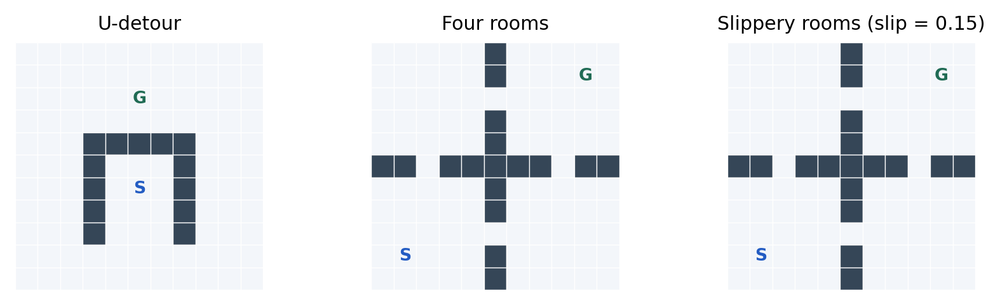
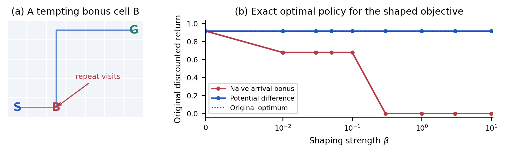
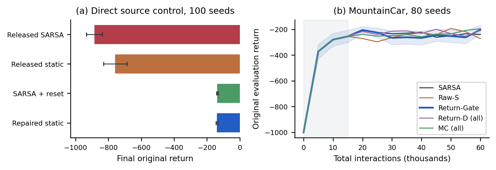
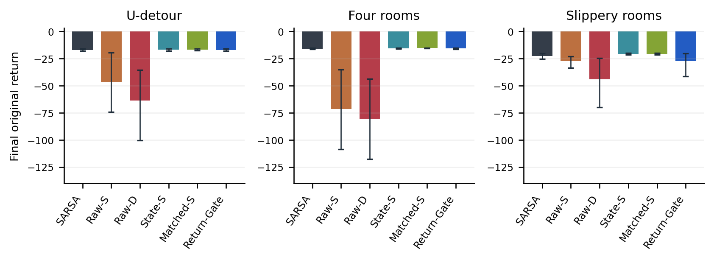

# Pheromone-Inspired Reward Shaping: Return Calibration, Representation, and Memory Retention

CS4620J Reinforcement Learning — Final Research Project

## Abstract

We study how trajectory experience should be converted into potential-based reward shaping while evaluating the original task objective. Inspired by pheromone-based heuristics, we construct state potentials from quality-weighted trajectory returns, normalize their accumulation, and combine frozen early experience with online memory through a local evidence gate. A source-code control first identifies cross-episode eligibility traces as a major cause of unreliable final policies: resetting traces alone raises MountainCar evaluation success from 13.8% to 99.8% across 100 seeds. We then separate this implementation repair from the shaping contribution. In a fresh, prespecified validation with 20 training seeds per navigation task, the proposed mechanism improves original returns over raw pheromone baselines in U-detour and four-room navigation; all four comparisons survive Holm correction. The advantage does not replicate in stochastic navigation. Simple state-only pheromone controls achieve comparable performance, while stronger dynamic and Monte Carlo controls provide no evidence of an additional mixing benefit. An exact tempting-reward diagnostic separately verifies the role of the potential-difference safeguard. Our contribution is a reproducible shaping construction and a controlled account of when representation, experience retention, and implementation details can dominate apparent algorithmic gains.

## Introduction

Reward shaping offers additional feedback during reinforcement learning (RL), but its practical purpose is to improve performance on the original task. A high shaped return can instead reflect repeated collection of an auxiliary bonus. Potential-based reward shaping (PBRS) addresses objective preservation through a discounted potential difference [\[1\]](#ref-ng1999); it does not make an arbitrary heuristic informative or guarantee faster finite-budget learning.

Automatically constructing potentials from experience is therefore an important design problem. Pheromone-inspired methods summarize trajectories through deposition and evaporation. Bromuri’s released framework combines such heuristics with approximated SARSA and also examines their use for reward shaping [\[7\]](#ref-bromuri2019), [\[9\]](#ref-authorcode). A concentration score, however, is not an estimate of remaining task return. Its magnitude can reflect visitation, repeated reinforcement of earlier paths, and the representation used to compare actions.

We investigate a focused question: *under a matched interaction budget and learner, can a state potential constructed from empirical trajectory returns improve original-task performance relative to directly using pheromone concentration?* A secondary question asks whether adaptive static–dynamic mixing adds value after history retention and potential representation are controlled.

We implement a return-calibrated construction, termed Return-Gate: successful trajectories contribute quality-weighted remaining returns; repeated visits within a trajectory contribute only once per state bin; an early memory is retained while an online memory is introduced through a local count gate. This is a concrete combination of established ideas, not a new PBRS invariance theorem or a claim that Monte Carlo estimation or pheromone learning is new.

The experimental sequence is deliberately diagnostic. We first check the released learning loop, then evaluate shaping on the repaired common learner. An initial study motivates a fresh navigation validation and representation controls, with protocol and comparisons fixed before the fresh outcomes. The initial hypothesis that mixing consistently outperforms its components is not supported. The later validation confirms improvements over source-style raw scores in two deterministic tasks, but also finds that a simpler state-only score is sufficient to obtain similar performance.

Our contributions are:

-   A fully specified trajectory-return potential and memory-update mechanism, using real interactions without shortest-path labels or optimal-value supervision.

-   A minimal-change source-code control that separates a large implementation effect from the smaller shaping effects.

-   Independent-seed validation, representation controls, and matched-history baselines that bound the evidence for calibration and dynamic mixing, including non-replicating and negative results.

## Background and Related Work

### Original return and PBRS

For a capped episode of length $`T`$, define

$$
G_r=\sum_{t=0}^{T-1}\gamma^t r_t,\qquad
 F_t=\gamma\Phi(s_{t+1})-\Phi(s_t).
\qquad \text{(1)}
$$

The learner receives $`r_t+F_t`$; evaluation uses $`r_t`$ alone. For a fixed state potential during the episode,

$$
\sum_{t=0}^{T-1}\gamma^tF_t=-\Phi(s_0)+\gamma^T\Phi(s_T).
\qquad \text{(2)}
$$

Setting the episode’s terminal potential to zero removes the endpoint term. This boundary includes the time limit in our explicitly capped objective. It is different from treating a time limit as a continuation of an infinite-horizon task. Episodic boundary handling is consequential [\[6\]](#ref-grzes2017).

We publish potentials between episodes and freeze them inside an episode. Equation (2) then describes the episode conditional on its published potential. It is not a convergence proof for adaptive potentials, fixed learning rates, or linear function approximation. Dynamic PBRS has its own time-indexed formulation [\[4\]](#ref-devlin2012); dynamic change alone is not a reason that shaping must fail.

### Relationship to existing methods

Fixed state PBRS is closely related to suitable Q-value initialization under the conditions analyzed by Wiewiora [\[2\]](#ref-wiewiora2003). Consequently, a useful effect need not reflect additional task information at every step. The baseline’s initialization, representation, and information access all matter. State–action advice requires additional care in action-value interpretation [\[3\]](#ref-advice2003); an action-dependent score cannot automatically inherit the argument for a state-only offset.

Bromuri [\[7\]](#ref-bromuri2019) reports earlier discovery of the best training trajectory with a static pheromone potential, while its dynamic shaping extension is less beneficial. We examine the released implementation and regenerate the unavailable static prior. We do not reproduce an original pretrained artifact. Our source-style raw controls preserve the deposition formulas on a common repaired learner; they are distinct from the exact-source audit and from all possible principled state–action advice algorithms.

Müller and Kudenko [\[8\]](#ref-muller2025) studies how potential scale and shift interact with rewards and initial Q-values. Its MountainCar experiments use DQN, $`\gamma=.99`$, a 200-step cap, and exponential velocity potentials. We transfer only simple velocity heuristics into our SARSA setting. In particular, adding one to a linear velocity potential is not that paper’s reward-bias parameter, whose potential shift is $`b/(\gamma-1)`$. Cross-paper raw scores are not a common-protocol ranking.

## Trajectory-Return Potentials

### A trajectory-level memory

A successful real trajectory $`k`$ contains rewards $`r_{k,t}`$ and length $`T_k`$. Its remaining discounted return is

$$
G_{k,t}=\sum_{j=t}^{T_k-1}\gamma^{j-t}r_{k,j},
 \qquad q_k=T_k^{-1}.
\qquad \text{(3)}
$$

For state bin $`s`$, let $`t_k(s)`$ be its last visit in that trajectory. At each successful episode, both memory arrays evaporate by $`\rho=.99`$. For every distinct visited bin, we then add

$$
\begin{aligned}
W(s)&\leftarrow W(s)+q_k,\\
 M(s)&\leftarrow M(s)+q_k G_{k,t_k(s)}.
\end{aligned}
\qquad \text{(4)}
$$

The value hint is $`\widehat V(s)=M(s)/W(s)`$ when $`W(s)\gt 0`$; an unseen bin receives the fixed reference value $`-200`$. Repeated visits in one trajectory do not create multiple evidence counts. Failed trajectories still update SARSA through their real rewards, but do not reinforce this success-conditioned memory. In the unweighted Monte Carlo (MC) control, $`q_k=1`$.

The ratio gives the hint an empirical return scale, rather than making its magnitude grow directly with the number of deposits. It does not remove behavior-policy selection bias. Last visits, success conditioning, quality weighting, and state aggregation also prevent interpreting it as an unbiased $`V^\pi`$ or an already-known $`V^*`$. The reference value is a design choice, not a theoretically derived bound.

### Retained and online experience

All methods first use unshaped rewards for 25% of the interaction budget, rounded up to a complete episode. We retain the learned Q-values. A frozen memory $`A`$ is copied at that boundary, and a separate online memory $`D`$ receives subsequent successful trajectories. Their state potentials are

$$
\Phi_A(s)=c\widehat V_A(s),\qquad
 \Phi_D(s)=c\widehat V_D(s),\qquad c=.1.
\qquad \text{(5)}
$$

If $`n_D(s)`$ counts distinct new successful trajectories visiting $`s`$, the selected mixture is

$$
\begin{aligned}
b(s)&=b_{\max}\frac{n_D(s)}{n_D(s)+\kappa},\\
 \Phi(s)&=(1-b(s))\Phi_A(s)+b(s)\Phi_D(s),
\end{aligned}
\qquad \text{(6)}
$$

with $`b_{\max}=.5`$ and $`\kappa=5`$. A state without new evidence retains its anchor. These are heuristic gates, not statistical confidence bounds: trajectories are policy-dependent and their counts need not represent independent, identically distributed samples.

After initialization, a new potential is published every ten completed episodes. The selected version does not clip publication amplitude. The initial study also tests a unit-change limit and a fixed 50/50 mixture. Parameters were fixed before fresh validation; the validation additionally tests $`c\in\{.03,.1,.3\}`$ without selecting a winner afterward.

**Figure 1.** Navigation conditions. S is the fixed start and G the goal. U-detour requires moving away from the goal before escaping the obstacle. Four rooms requires crossing narrow doorways. Slippery rooms uses the same layout with transition slip probability .15. Each condition uses one fixed layout; new seeds test reproducibility, not transfer to unseen maps.

### Interaction and publication

At an episode’s start we reset eligibility traces and obtain its actual initial potential. At each transition, we compute Equation (1), take the on-policy True Online SARSA update [\[5\]](#ref-seijen2014), and retain the potential used at arrival. True termination or the specified horizon uses zero future Q and zero terminal potential. At completion, real rewards update the appropriate memory, and publication may occur for the next episode. Every completed episode is checked against Equation (2).

All episodes, including the warm-up, count against the interaction budget. The memory does not use evaluation trajectories, transition-model planning, or hidden shortest-route information. MountainCar uses $`30\times30`$ bins; navigation uses grid cells. Q approximation retains the released action-specific tile geometry, ten tilings, and its bias feature.

## Experimental Design

### Tasks and budgets

Figure 1 shows the three navigation conditions. Every non-goal transition returns $`-1`$ and entering the goal returns zero; the episode cap is 200 and $`\gamma=.99`$. A timeout returns $`-200`$. Each navigation run receives 30,000 real interactions.

MountainCar uses the historical Gym dynamics [\[10\]](#ref-gymcode), goal position $`x\geq .5`$, reward $`-1`$ on every transition, a 1,000-step cap, and $`\gamma=1`$. Each matched-budget run receives 60,000 interactions. This task tests momentum-dependent behavior with continuous observations; the goal and reward differ from some textual descriptions of the original paper, so we do not claim an exact match to every reported condition.

The common learner has $`\lambda=.9`$, constant $`\epsilon=.025`$, and step size $`.1/10`$ in navigation or $`.5/10`$ in MountainCar. The exact-source audit instead retains the released exploration schedule, multiplying $`\epsilon`$ by $`.99`$ at every step, and runs 200 complete episodes. These protocols answer different questions and are not pooled.

### Cohorts and baseline definitions

**Source audit.** We use 100 paired seeds, 20000–20099. The minimal intervention clears traces immediately before calling the released, complete `learn()` method. The static prior is regenerated by an independent teacher with 1,000 episodes and 111,259 interactions; the same fixed prior is reused across students. Its cost is disclosed separately. These are conditional transfer comparisons, not equal-total-budget demonstrations against cold-start SARSA.

**Initial controlled study.** Eight discovery seeds, 30000–30007, select the existing unbounded Return-Gate configuration. Independent confirmation uses 80 MountainCar seeds and 30 seeds per navigation condition, starting at 31000. Further controls retain all early experience and match update amplitudes. These additional controls and comparisons are labeled supplementary; they do not replace the original failed mixing-superiority hypothesis.

**Fresh validation.** Based on the preceding diagnostic findings, we freeze ten methods and a new protocol before running seeds 40000–40019, 20 per navigation condition. This adds 600 runs and 18 million interactions. The method and hyperparameters are not retuned on this cohort. Identical warm-up trajectory hashes are verified across all methods and strengths.

The principal methods are:

-   **SARSA**: no shaping, same learner and total budget.

-   **Raw-S / Raw-D**: released-style action-dependent pheromone scores, frozen after warm-up or updated using the original local/global rules.

-   **Return-S**: the calibrated early state potential, frozen after warm-up.

-   **Return-Gate**: Equation (6), our selected combination.

-   **Return-D (all)**: a calibrated dynamic memory retaining *all* early and later samples. **MC (all)** uses the same full-history construction without quality weights. Both have unrestricted publication amplitude.

The initial online-only dynamic control intentionally starts its potential memory from post-warm-up trajectories; Q is retained. It is weaker than a dynamic estimator retaining all data, and is never presented as the only dynamic baseline.

Fresh representation controls add State-S, the action-average of frozen raw scores, and Matched-S, an affine transformation of that state score. The latter matches the mean and standard deviation of the calibrated anchor on successfully observed warm-up states only. It does not fit each state’s return target. Both freeze after warm-up. They test whether eliminating action dependence or a simple scale/offset adjustment is already sufficient to explain the observed improvement.

### Evaluation and statistical protocol

We freeze Q and use greedy actions with deterministic first-index tie breaking. MountainCar is evaluated at 20 fixed starts uniformly spaced over $`[-.6,-.4]`$ with zero initial velocity. Slippery rooms uses 20 evaluation episodes per trained seed; deterministic navigation uses its single fixed start. Success means reaching the goal, including on the final permitted transition. Evaluations do not update any memory.

Tables report mean original undiscounted capped return and between-training-seed standard deviation. We also retain original discounted return and learning-curve area under the curve (AUC), defined as the trapezoidal integral of original evaluation return over interactions divided by the budget. Theory and the exact goal diagnostic refer to $`G_r`$ in Equation (1); undiscounted and discounted metrics are not conflated. Larger values are better for both return metrics.

The unit of analysis is a trained seed, not an evaluation episode. We use 20,000 paired bootstrap resamples for descriptive 95% intervals and 20,000 random sign flips for two-sided paired tests. The fresh primary family contains six comparisons of Return-Gate against Raw-S/Raw-D across three conditions, adjusted jointly by Holm at $`.05`$. A 15-test secondary family compares state-score, static-return, MC and SARSA controls; a six-test family examines the two alternative strengths. The earlier study’s 20 primary tests, its post-hoc comparisons, and these new families are distinguished throughout.

## Results

### A goal-preservation diagnostic

We first isolate objective alignment from learning. A fully known $`5\times7`$ grid has a sparse $`+1`$ goal reward, a 40-step horizon, and $`\gamma=.99`$. A deliberately tempting feature is $`h(s)=1`$ at bonus cell B and zero elsewhere. Exact finite-horizon dynamic programming optimizes either a naive arrival bonus $`\beta h(s')`$ or the PBRS difference $`\beta(\gamma h(s')-h(s))`$, using zero potential at the goal and horizon.

**Figure 2.** Exact goal-preservation diagnostic, not a sampled learning experiment. (a) A repeatable feature at B creates a tempting reward. Blue shows a shortest goal route. (b) An agent optimizing naive bonus rewards delays the goal at $`\beta=.01`$–$`.1`$, reducing original discounted return from .914 to .676; at $`\beta\geq .3`$ it never reaches the goal within the horizon. Correctly bounded PBRS preserves the original optimum at every tested strength.

Without shaping, the optimal goal route takes ten steps and returns $`\gamma^9=.9135`$. Naive shaping makes prolonged bonus collection optimal, and eventually makes abandoning the goal optimal. PBRS preserves the original optimal return at all nine tested strengths, including zero (Figure 2). The maximum full-value identity error is $`1.22\times10^{-15}`$. This checks the safeguard’s objective accounting. It neither demonstrates our learned potential’s accuracy nor establishes a sample-efficiency advantage.

### Implementation repair

The released TrueOnline branch carries eligibility traces between episodes, while resetting other episode-level variables. Calling the same released learning method after clearing traces raises final MountainCar success from 13.8% to 99.8% and mean original return from $`-885.86`$ to $`-136.91`$. The paired improvement is $`748.95`$, with bootstrap interval $`[700.61,793.28]`$ and six-test adjusted $`p\lt .001`$. Ninety-nine of 100 seeds improve.

Our equivalent reset implementation matches the direct-source training outcomes; final weights differ by at most $`1.20\times10^{-12}`$. A standard Dutch-trace update with reset obtains $`-138.46`$, not a further supported gain over reset alone. Thus the large improvement is not credited to a new shaping rule. The combined repaired static learner obtains $`-139.82`$ and 99.9% success, also close to repaired plain SARSA (Figure 3a).

**Table 1.** Comparison with the published static-shaping result. ABS and AIBS are smaller-is-better training-record statistics, not final-policy return.

| Static shaping version                      |    ABS |   AIBS |
|:--------------------------------------------|-------:|-------:|
| Published Table 7 [\[7\]](#ref-bromuri2019) | 101.40 |  75.00 |
| Released-code attempt                       | 103.04 |  90.95 |
| Our repaired implementation                 | 100.33 | 115.30 |

Table 1 separates paper-level context from local evidence. The public metric code records an index $`t=T-1`$, so our static ABS of 100.33 corresponds to 101.33 physical steps. AIBS is the zero-based index of the earliest best record, not time to a shared success threshold. A better record found later can increase AIBS. The nominal ABS difference is not evidence of superiority over the published experiment; AIBS is later, original artifacts are missing, and comparable final frozen-policy returns were not reported there.

**Figure 3.** Two distinct protocols. (a) Minimal source audit: 200 episodes, 100 seeds, mean final original return with approximate 95% mean intervals; only the SARSA trace-reset comparison is a single-change intervention. (b) Matched-budget MountainCar, 80 seeds: original evaluation learning curves, with the initial 25% warm-up shaded and a 95% normal mean band for Return-Gate. Neither repaired-source gains nor a favorable last checkpoint establish a shaping acceleration advantage.

### Initial study and memory controls

Table 2 summarizes the independent initial cohort, retaining full-history supplementary baselines. Its post-hoc comparisons of Return-Gate against raw concentrations support improvements in all three navigation conditions. However, none of the original 20 Holm-adjusted primary comparisons establishes an additional mixing advantage over calibrated components, SARSA, or MC. This distinction remains part of the report after the new validation.

**Table 2.** Initial independent cohort: mean original return ± between-seed SD. Navigation uses 30 seeds; MountainCar uses 80. Return-D (all) and MC (all) are supplementary matched-history, unrestricted-amplitude controls. These data motivated the fresh protocol; they are not pooled with it.

| Method         |           U-detour |         Four rooms |     Slippery rooms |          MountainCar |
|:---------------|-------------------:|-------------------:|-------------------:|---------------------:|
| SARSA          |  -16.93 ± 1.70 |  -15.80 ± 1.71 | -22.86 ± 13.24 | -240.13 ± 216.30 |
| Raw-S          | -55.67 ± 73.44 | -47.23 ± 69.50 | -38.86 ± 46.90 | -272.10 ± 273.13 |
| Raw-D          | -43.73 ± 62.40 | -77.60 ± 88.04 | -42.48 ± 51.47 | -244.58 ± 187.63 |
| Return-S       | -23.23 ± 33.44 |  -15.60 ± 1.19 |  -21.16 ± 5.81 | -247.71 ± 227.42 |
| Return-Gate    |  -17.00 ± 1.89 |  -15.67 ± 1.21 |  -20.32 ± 2.91 | -202.74 ± 166.86 |
| Return-D (all) |  -17.07 ± 1.93 | -22.10 ± 33.63 |  -20.59 ± 2.99 | -209.75 ± 196.36 |
| MC (all)       |  -17.13 ± 1.89 | -21.83 ± 33.67 |  -21.26 ± 4.90 | -195.59 ± 134.86 |

The MountainCar comparison is especially informative. Return-Gate averages $`-202.74`$, versus $`-303.62`$ for an online-only calibrated potential. Retaining all early experience gives $`-208.01`$ with the same unit-change bound, and $`-209.75`$ without it. MC with all data and unrestricted updates gives $`-195.59`$. The apparent gap is therefore sensitive to whether early potential evidence is discarded. No additional benefit over these stronger controls is detected. Figure 3b and the AUC comparisons also provide no supported claim of stable acceleration.

### Fresh navigation validation

Table 3 and Figure 4 show the full fresh cohort. In U-detour, Return-Gate averages $`-17.10`$, versus $`-46.45`$ for Raw-S and $`-63.85`$ for Raw-D. In four rooms, it averages $`-15.80`$, versus $`-71.60`$ and $`-80.75`$. All four primary deterministic-task comparisons survive the prespecified six-test Holm adjustment (Table 4). Return-Gate reaches the goal for every trained policy in these two conditions.

**Figure 4.** Fresh validation on 20 previously unused seeds per condition. Bars show mean final original return; error bars are bootstrap 95% intervals across training seeds. Raw action-dependent scores exhibit large failure variability. State-only and moment-matched static controls already approach SARSA in deterministic navigation and have better stochastic-task means than Return-Gate. This limits attribution to return calibration or adaptive mixing.

**Table 3.** Fresh validation: all ten prespecified methods, original return ± SD, 20 seeds each. Every arm uses 30,000 real interactions. Alternative strengths are reported without selecting a new preferred method.

| Method                |           U-detour |         Four rooms |     Slippery rooms |
|:----------------------|-------------------:|-------------------:|-------------------:|
| SARSA                 |  -17.00 ± 2.05 |  -15.90 ± 1.21 |  -22.49 ± 6.13 |
| Raw-S                 | -46.45 ± 66.22 | -71.60 ± 86.25 | -27.27 ± 13.36 |
| Raw-D                 | -63.85 ± 80.68 | -80.75 ± 89.80 | -44.07 ± 54.50 |
| State-S               |  -16.90 ± 2.10 |  -15.60 ± 0.94 |  -20.58 ± 1.64 |
| Matched-S             |  -16.80 ± 1.94 |  -15.40 ± 0.82 |  -20.68 ± 1.83 |
| Return-S              |  -17.20 ± 2.33 | -25.05 ± 41.20 | -27.13 ± 30.40 |
| Return-Gate           |  -17.10 ± 2.20 |  -15.80 ± 1.20 | -27.45 ± 30.34 |
| MC (all)              |  -17.10 ± 2.20 |  -15.90 ± 1.21 | -27.29 ± 30.33 |
| Return-Gate ($`c=.03`$) |  -17.20 ± 2.33 |  -16.10 ± 1.65 | -29.36 ± 40.18 |
| Return-Gate ($`c=.30`$) |  -17.50 ± 2.33 |  -16.30 ± 1.75 |  -21.79 ± 5.06 |

The stochastic result does not replicate the initial advantage. Return-Gate averages $`-27.45`$, compared with Raw-S at $`-27.27`$ and Raw-D at $`-44.07`$; neither adjusted comparison rejects the null. Its success rate is 96.25%, below SARSA’s 100% and Raw-S’s 99.25%, although above Raw-D’s 89.5%. Thus the earlier 100% stochastic evaluation success was a cohort-specific finding, not a robustness guarantee.

**Table 4.** Fresh primary comparisons: Return-Gate minus raw control, paired 95% intervals. $`p_H`$ corrects six tests. U/F/S denote U-detour/four/slippery rooms.

| Task | Control | $`\Delta R`$ |        95% interval | $`p_H`$ |
|:-----|:--------|-----------:|--------------------:|------:|
| F    | Raw-S   |     +55.80 |  \[+19.10, +92.80\] | 0.041 |
| F    | Raw-D   |     +64.95 | \[+28.05, +102.05\] | 0.023 |
| S    | Raw-S   |      -0.17 |  \[-16.70, +11.68\] | 1.000 |
| S    | Raw-D   |     +16.62 |   \[-6.24, +45.67\] | 0.510 |
| U    | Raw-S   |     +29.35 |   \[+2.40, +57.80\] | 0.041 |
| U    | Raw-D   |     +46.75 |  \[+17.80, +83.35\] | 0.041 |

### Representation and sensitivity

Both simple state controls succeed in all fresh navigation evaluations, including the stochastic condition. In U-detour, State-S and Matched-S average $`-16.90`$ and $`-16.80`$; in four rooms, $`-15.60`$ and $`-15.40`$; in slippery rooms, $`-20.58`$ and $`-20.68`$. The selected method does not show an advantage over these controls in the 15-test secondary family. State aggregation and a simple affine adjustment are therefore plausible contributors to the raw-versus-calibrated gap. These controls do not prove that any one representation change is the unique cause, and non-rejection is not an equivalence test.

The return scale check also argues for bounded claims. Changing $`c`$ from $`.1`$ to $`.03`$ or $`.3`$ leaves deterministic means near $`-17`$ and $`-16`$, respectively. In slippery rooms, the three means are $`-29.36`$, $`-27.45`$, and $`-21.79`$, with substantial variance. None of the six adjusted strength comparisons rejects the null. The favorable $`.3`$ stochastic mean is not used to replace the selected configuration. We have checked a small sensitivity range, not established parameter-insensitive robustness.

## Discussion

The evidence supports a concrete automatic potential constructor and a useful diagnosis of pheromone shaping. It also narrows the initial mechanistic explanation. Across fresh seeds, the complete return-based mechanism improves source-style raw baselines in deterministic navigation, but the simpler state-only alternatives achieve similar or better means. Accordingly, the experiment does not identify return calibration, quality weighting, or the local gate as individually necessary components.

The three levels of evidence should remain separate. First, the trace-reset intervention has strong direct causal support in the released learning loop. Second, the fresh raw-baseline comparisons establish a finite-budget performance difference for the complete method in two conditions. Third, the attribution of that difference to any particular potential or memory component remains incomplete. Repair gains are not shaping gains, and improved final returns are not by themselves faster learning.

The published theory also has a precise role. Equation (2) explains objective accounting under the specified boundaries. It does not ensure that a misleading potential guides useful exploration. Our exact bonus-cell diagnostic makes this distinction visible without relying on one successful training trajectory. The original return, discounted return, success rate, and learning curve each answer different practical questions.

Several limitations remain. Each navigation condition has one layout. A new seed is not a new map or a transfer test. Success-conditioned last-visit memories can be optimistic; the unobserved-state reference, count gate, evaporation and 25% split have not all been swept. A monotone count gate may retain stale confidence. MountainCar discretization can alias states. Fixed step sizes, small exploration, and capped budgets do not establish convergence. The moment-matched control matches only two moments, and no fully matched correction of the released state–action advice learner is tested.

Related work provides interpretation rather than an algorithm leaderboard. Dynamic PBRS can retain policy guarantees with a correct formulation [\[4\]](#ref-devlin2012); potential shifts can affect learning despite encoding similar preferences [\[8\]](#ref-muller2025). Our simple velocity and Manhattan controls are heuristic transfers, not full replications of those papers. The limited published-metric comparison in Table 1 is insufficient to claim that we outperform the original study.

## Conclusion

We designed and evaluated a pheromone-inspired, trajectory-return state potential with retained early experience and online updates. A minimal released-code intervention first removed a large confounder in final-policy reliability. Independent fresh validation then confirmed gains over raw pheromone controls in deterministic U-detour and four-room navigation, while exposing a non-replicating stochastic advantage. Representation and full-history baselines sharply restrict the evidence for a unique calibration or mixing benefit. The resulting contribution is an executable shaping design and an empirically grounded boundary: potential representation, episode handling, and comparable experience retention must be checked before attributing gains to a more elaborate adaptive mechanism.

**Reproducibility and tool use.** The accompanying source package contains frozen protocols, seeds, run records, models, generator diffs, statistical scripts, and Python code producing all figures and tables. It identifies the released source commit and retains its attribution. The original 3,660-run series and the 600 fresh runs remain separate. AI-assisted tools were used for implementation, analysis and drafting; the numerical claims are linked to executable scripts and saved records.

## References

1. Andrew Y. Ng, Daishi Harada, and Stuart Russell. Policy invariance under reward transformations: Theory and application to reward shaping. In *Proceedings of ICML*, pp. 278–287, 1999. <https://people.eecs.berkeley.edu/~russell/papers/icml99-shaping.pdf>.

2. Eric Wiewiora. Potential-based shaping and Q-value initialization are equivalent. *Journal of Artificial Intelligence Research*, 19:205–208, 2003. <https://doi.org/10.1613/jair.1190>.

3. Eric Wiewiora, Garrison Cottrell, and Charles Elkan. Principled methods for advising reinforcement learning agents. In *Proceedings of ICML*, 2003. <https://cdn.aaai.org/ICML/2003/ICML03-103.pdf>.

4. Sam Devlin and Daniel Kudenko. Dynamic potential-based reward shaping. In *Proceedings of AAMAS*, pp. 433–440, 2012. <https://eprints.whiterose.ac.uk/id/eprint/75121/2/p433_devlin.pdf>.

5. Harm van Seijen and Richard S. Sutton. True online TD($`\lambda`$). In *Proceedings of ICML*, PMLR 32(1):692–700, 2014. <https://proceedings.mlr.press/v32/seijen14.html>.

6. Marek Grześ. Reward shaping in episodic reinforcement learning. In *Proceedings of AAMAS*, pp. 565–573, 2017. <https://www.ifaamas.org/Proceedings/aamas2017/pdfs/p565.pdf>.

7. Stefano Bromuri. Dynamic heuristic acceleration of linearly approximated SARSA($`\lambda`$): Using ant colony optimization to learn heuristics dynamically. *Journal of Heuristics*, 25:901–932, 2019. <https://doi.org/10.1007/s10732-019-09408-x>.

8. Henrik Müller and Daniel Kudenko. Improving the effectiveness of potential-based reward shaping in reinforcement learning. *arXiv:2502.01307*, 2025. <https://arxiv.org/abs/2502.01307>.

9. SB-BISS / Stefano Bromuri. RLACOSarsaLambda: Released implementation. Fixed commit `95786b39b9ee8c5e004e71ccfa790304cbb3f684`, 2019. [`github.com/SB-BISS/RLACOSarsaLambda`](https://github.com/SB-BISS/RLACOSarsaLambda/tree/95786b39b9ee8c5e004e71ccfa790304cbb3f684).

10. OpenAI. Gym MountainCar environment, version 0.10.5. [`github.com/openai/gym`](https://github.com/openai/gym/blob/v0.10.5/gym/envs/classic_control/mountain_car.py), 2018.
